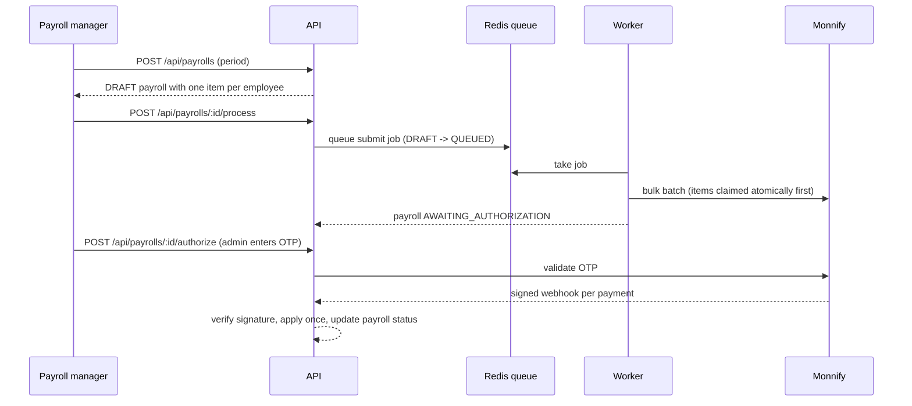

# Monnify Payroll API

A payroll backend that pays employees in bulk through [Monnify](https://monnify.com) disbursements. It is built around one rule: **never pay anyone twice and never lose track of a payment.**

TypeScript · Node.js · Express · PostgreSQL · Redis · BullMQ · Docker

## What it does

- Manages employees and their bank details (salary stored in kobo, never as floats).
- Builds a payroll run for a period, then submits it to Monnify as one bulk batch from a background worker.
- Handles Monnify's OTP step, then settles each payment from Monnify's signed webhooks.
- Reconciles automatically, so a lost webhook or a timed-out request never leaves money in limbo.
- Protects every route with JWT auth and three roles. Every sensitive action is written to an audit log.

## How a payroll run flows



## Design decisions worth knowing

| Concern              | What the code does                                                                                                                                                                                                                |
| -------------------- | --------------------------------------------------------------------------------------------------------------------------------------------------------------------------------------------------------------------------------- |
| Double payment       | Items are claimed with a single `UPDATE ... WHERE status = 'PENDING'`, so two workers can never submit the same item. Only one live payroll per period is allowed (partial unique index). Processing a payroll twice returns 409. |
| Unknown outcome      | If a request to Monnify times out or returns 5xx, items stay `PROCESSING` instead of being retried blindly. Reconciliation asks Monnify per payment reference. Only a "not found" answer returns an item to `PENDING`.            |
| Webhook authenticity | Monnify signs the raw body with HMAC-SHA512 using your secret key. The webhook route is mounted before the JSON parser, verifies the exact bytes with a constant-time comparison, and returns 401 otherwise.                      |
| Webhook retries      | Each applied body is stored by hash inside the same transaction as the status change. A redelivery is recognised and ignored, and a failure rolls back so Monnify's retry can succeed.                                            |
| Concurrent webhooks  | The payroll row is locked while its status is recomputed, so simultaneous webhooks can't leave it stuck in a stale status.                                                                                                        |
| Retrying failures    | Failed items get a new payment reference (`...-2`, `...-3`) because gateways reject reused references.                                                                                                                            |
| Money                | Integer kobo in the database, converted to naira only at the API edge and when calling Monnify.                                                                                                                                   |
| Access               | Roles: `ADMIN`, `PAYROLL_MANAGER`, `VIEWER`. Viewers see masked account numbers. Only admins can enter the OTP or manage users.                                                                                                   |

## Quick start with Docker

```bash
cp .env.example .env          # add your Monnify sandbox keys and a real JWT_SECRET
docker compose up --build     # postgres, redis, api (runs migrations), worker
docker compose exec api node dist/db/seed-admin.js   # creates the first admin from ADMIN_EMAIL / ADMIN_PASSWORD
```

## Quick start without Docker

Requires Node 20+, PostgreSQL 14+ and Redis 6+.

```bash
npm install
cp .env.example .env
npm run migrate
npm run seed:admin
npm run dev            # API on :3000
npm run dev:worker     # in a second terminal
```

## Try the whole flow with no Monnify account

`npm run fake-monnify` starts a local stand-in for Monnify. Set `MONNIFY_BASE_URL=http://localhost:4010` and `MONNIFY_SECRET_KEY` in `.env`, start the API and worker, then run:

```bash
npm run smoke
```

The smoke test logs in, creates employees, runs a payroll, rejects a wrong OTP, authorizes with the right one, receives signed webhooks, checks bad-signature and duplicate-webhook handling, retries a failed payment and confirms nobody was paid twice. In the fake, the OTP is `123456`, and accounts ending in `0000` fail on their first attempt.

## API

All routes except login and the webhook need `Authorization: Bearer <token>`.

| Method and path                                         | Who      | Purpose                                                                        |
| ------------------------------------------------------- | -------- | ------------------------------------------------------------------------------ |
| `POST /api/auth/login`                                  | anyone   | Exchange email and password for a token                                        |
| `POST /api/users`, `GET /api/users`                     | admin    | Manage users                                                                   |
| `POST /api/employees`                                   | manager  | Create an employee (code like `EMP-0001` is generated)                         |
| `GET /api/employees`, `GET /api/employees/:id`          | any role | Read employees                                                                 |
| `PATCH /api/employees/:id`, `DELETE /api/employees/:id` | manager  | Update or deactivate                                                           |
| `POST /api/payrolls`                                    | manager  | Create a payroll for `period` (`YYYY-MM`), optionally for chosen `employeeIds` |
| `GET /api/payrolls`, `GET /api/payrolls/:id`            | any role | List, or one payroll with item summary                                         |
| `POST /api/payrolls/:id/process`                        | manager  | Queue for submission to Monnify                                                |
| `POST /api/payrolls/:id/authorize`                      | admin    | Submit the OTP for the batch                                                   |
| `POST /api/payrolls/:id/retry-failed`                   | manager  | Re-queue only the failed items                                                 |
| `POST /api/payrolls/:id/reconcile`                      | manager  | Ask Monnify about items still `PROCESSING`                                     |
| `GET /api/wallet/balance`                               | manager  | Monnify wallet balance                                                         |
| `POST /webhooks/monnify`                                | Monnify  | Signed disbursement events                                                     |
| `GET /health`, `GET /ready`                             | anyone   | Liveness, and readiness (checks the database)                                  |

Payroll statuses: `DRAFT`, `QUEUED`, `AWAITING_AUTHORIZATION`, `PROCESSING`, `COMPLETED`, `PARTIALLY_COMPLETED`, `FAILED`.

Example:

```bash
TOKEN=$(curl -s localhost:3000/api/auth/login -H 'content-type: application/json' \
  -d '{"email":"admin@example.com","password":"your-admin-password"}' | jq -r .token)

curl -s localhost:3000/api/employees -H "authorization: Bearer $TOKEN" -H 'content-type: application/json' \
  -d '{"fullName":"Ada Obi","email":"ada@example.com","salary":250000,"bankCode":"058","accountNumber":"0123456789"}'

curl -s localhost:3000/api/payrolls -H "authorization: Bearer $TOKEN" -H 'content-type: application/json' \
  -d '{"period":"2026-10"}'
```

## Going live checklist

Run it against Monnify's **sandbox** first and confirm these assumptions, which live in `src/lib/monnify.ts` and `src/modules/payrolls/service.ts`:

1. The bulk response reports an OTP-pending batch with a status containing `PENDING_AUTHORIZATION`.
2. `GET /api/v2/disbursements/single/summary?reference=` is the right status lookup and returns `SUCCESS`, `FAILED` or similar.
3. Webhook events arrive as `SUCCESSFUL_DISBURSEMENT`, `FAILED_DISBURSEMENT` and `REVERSED_DISBURSEMENT` with `eventData.reference` set to your payment reference.
4. Set the webhook URL in the Monnify dashboard to `https://your-host/webhooks/monnify`. Monnify's docs list the source IP it sends from, which you can allowlist at your proxy.

Also: use a strong `JWT_SECRET`, serve over HTTPS, keep `.env` out of git (it is in `.gitignore`), and put the API behind a reverse proxy that sets `X-Forwarded-For`.

## Project layout

```
src/
  app.ts, server.ts, worker.ts     app factory, API entry, queue worker entry
  config/env.ts                    validated environment
  db/                              pool, migrations, admin seed
  lib/monnify.ts                   Monnify client, batch payload, signature check
  middleware/                      JWT auth, roles, validation, errors
  modules/                         auth, users, employees, payrolls (service, status rules, routes)
  queue/payrollQueue.ts            BullMQ queue
  webhooks/monnify.ts              raw-body, signature-verified webhook route
scripts/                           fake-monnify, smoke
test/                              unit and HTTP tests (npm test)
```

## Tests

```bash
npm run typecheck
npm test            # signature check, status rules, payload mapping, auth and role guards
npm run smoke       # end to end, needs the stack running
```

## Not included yet

API docs (OpenAPI), email notifications, multi-currency and scheduled payroll runs. The worker already has a repeatable job, so scheduling is a small addition.

## Author

**Emmanuel Seun Shittu**, Software Engineer

- GitHub: [github.com/shem4soul](https://github.com/shem4soul)
- LinkedIn: [linkedin.com/in/emmanuel-shittu91573915a](https://linkedin.com/in/emmanuel-shittu91573915a)

## License

MIT
